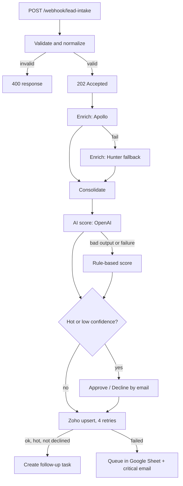

# AI Lead Intake to Zoho CRM (n8n)

A production-style lead pipeline: a web form posts a lead, n8n validates it, enriches it, scores it with AI, asks a human to approve the important ones, writes it to Zoho CRM with retries, and creates a follow-up task. Nothing is lost if a service fails.

## Flow



## Files

| File | Purpose | Nodes |
|---|---|---|
| `ai-lead-intake-zoho-crm.json` | Main lead pipeline | 25 |
| `global-error-handler.json` | Shared error workflow with selective, throttled Gmail alerts | 4 |

## How it works

**Intake.** `POST /webhook/lead-intake` with JSON like:
```json
{ "name": "Jane Smith", "email": "jane@acme.com", "phone": "+1555...", "company": "Acme", "message": "Need a quote", "source": "Website" }
```
Email format and a name are validated. Invalid requests get a 400. Valid ones get a 202 straight away, so the form never waits on enrichment or the CRM. Free-mail domains (gmail, yahoo, outlook and similar) are flagged.

**Enrichment.** Apollo people-match first, Hunter people-find as the fallback. The results are merged into one object (title, company, industry, employee count, LinkedIn).

**AI scoring.** OpenAI returns a score (0 to 100), a tier (hot / warm / cold), a confidence, a summary, a next action and a spam flag. If the call fails or the output is malformed, a deterministic rule score takes over:

| Signal | Points |
|---|---|
| Base | 20 |
| Business email (not free-mail) | +20 |
| Company given | +10 |
| Phone given | +10 |
| Message mentions budget / quote / pricing / demo / urgent / proposal / hire | +20 |
| Senior title (CEO, founder, director, VP, manager ...) | +15 |
| 50+ employees | +5 |

Tiers: 75 and above is hot, 45 to 74 is warm, below that is cold. Fallback scores carry a confidence of 0.4, so they are always sent for review.

**Human-in-the-loop.** Hot leads and any lead with AI confidence below 0.5 trigger an Approve / Decline email (Gmail send-and-wait). The pipeline pauses until the approver responds. Spam is never sent for review. A decline stops the follow-up task.

**Zoho CRM.** Upsert on `Email` (duplicate check), with 4 retries. Lead status maps from the tier: hot is `Pre-Qualified`, warm is `Not Contacted`, cold is `Contact in Future`. The AI summary, next action, source, message and LinkedIn URL are written into the description. Hot, non-declined leads get a follow-up task.

**Failure path.** If Zoho still fails, the lead is appended to the `CRM_Fallback_Queue` Google Sheet and a critical email is sent, so no lead is dropped.

## Error handler
`global-error-handler.json` classifies failures and keeps alerts quiet:
- Auth, token, quota and payment errors are **CRITICAL**; Zoho / CRM node errors are **HIGH**; the rest are **MEDIUM**.
- Enrichment errors (Apollo / Hunter) are suppressed unless they are auth or quota problems, because those nodes already have a fallback.
- The same error is emailed at most once every 30 minutes.

## Setup
1. Import both workflows. In the lead workflow, set Settings > Error Workflow to **Global Error Handler**.
2. Create credentials: Zoho OAuth2, Gmail OAuth2, OpenAI, Google Sheets, Apollo (Header Auth, `x-api-key`), Hunter (Query Auth, `api_key`).
3. Set the approver email, the Sheet ID (tab `CRM_Fallback_Queue`) and the alert recipient.
4. Zoho data centre: change `zohoapis.com` to `.eu`, `.in` or `.com.au` if your org is not on `.com`.
5. Test with the webhook test URL, then activate and point your form at the production URL.

## Customising
Scoring weights and tier thresholds live in the `Parse AI Score` / `Rule-Based Score` Code nodes. Field mapping to Zoho is in `Build Zoho Payload`.

## Tech
n8n, Zoho CRM, OpenAI, Apollo, Hunter, Gmail, Google Sheets.
